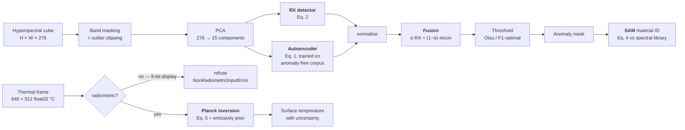

# Spectral–Spatial Anomaly Detection in Hyperspectral and Thermal Remote Sensing

A research prototype that finds **anomalous pixels** in airborne imagery, then
says **what they are made of** and **how hot they are** — combining a classical
statistical detector with a 3D-convolutional autoencoder, and validating every
equation against an independent implementation.

Backs a conference paper by Atharv Donadkar et al., JD College of Engineering &
Management, Nagpur. 494 unit tests; all five milestones have measured results.

---

## 1. The problem

A **hyperspectral** image is a cube: two spatial dimensions and a third holding
a full reflectance spectrum at every pixel. AVIRIS-NG, the sensor used here,
records **276 usable bands from 455 to 2410 nm** — so each pixel is a 276-element
vector describing how that patch of ground reflects light across the visible and
short-wave infrared.

Anomaly detection asks: **which pixels do not belong?** Unsupervised, with no
examples of the target — a vehicle in scrubland, a fabric panel in a field, a
mineral outcrop. The difficulty is that a target is usually *smaller than a
pixel*: a 3 m ground sample with a 1 m object gives a mixture that is ~10 % target
and ~90 % background, and the detector has to notice a 10 % perturbation of a
276-dimensional vector.

A **thermal** image is the same idea with one band, but the pixel value is a
physical temperature rather than a reflectance. That enables a different
question — not just *where* is the anomaly, but *how hot*, and *what material*
would have to be emitting to produce that reading.

This prototype implements four objectives:

| | objective | equation |
|---|---|---|
| **O1** | Detect anomalies in hyperspectral imagery | Eq. 1, 2, 3 |
| **O2** | Identify the material of a detected anomaly | Eq. 4 |
| **O3** | Detect anomalies in thermal imagery | — |
| **O4** | Retrieve physical temperature from thermal radiance | Eq. 5 |

---

## 2. Method

### 2.1 Pipeline



### 2.2 The two detection branches

**RX (Reed–Xiaoli), Eq. 2** — the classical benchmark detector. It models the
scene background as a single multivariate Gaussian and scores each pixel by its
squared Mahalanobis distance from the mean:

$$d_{RX}(\mathbf{x}) = (\mathbf{x}-\boldsymbol{\mu})^{\mathsf{T}}\,\boldsymbol{\Sigma}^{-1}(\mathbf{x}-\boldsymbol{\mu})$$

`Σ⁻¹` is what makes it work: it whitens the data, so a pixel is anomalous when it
departs from the background *in directions the background does not normally
vary*. A large deviation along a high-variance direction is ordinary; a small one
along a low-variance direction is not.

**Autoencoder, Eq. 1** — a 3D-convolutional network trained on an **anomaly-free**
corpus so it learns to reconstruct background and nothing else. A pixel that
reconstructs badly is one the background model has never seen:

$$E(\mathbf{x}) = \lVert \mathbf{x} - \hat{\mathbf{x}} \rVert_2$$

The encoder is three Conv3D layers (32 → 64 → 128 filters, kernels 3×3×7 →
3×3×5 → 3×3×3) over 7×7×15 spectral-spatial patches, bottlenecked to an
8-dimensional latent, with a mirrored decoder. Training uses a composite loss,
**Eq. 3**, that penalises both magnitude and *spectral shape* error:

$$\mathcal{L} = \mathrm{MSE}(\mathbf{x},\hat{\mathbf{x}}) + \lambda\,\mathrm{SAM}(\mathbf{x},\hat{\mathbf{x}})$$

The two branches fail differently — RX on targets that are statistically ordinary
but spatially odd, the autoencoder on targets resembling its training
distribution — so their normalised scores are fused:
`S = α·RX + (1−α)·E`, with α = 0.5.

### 2.3 Material identification, Eq. 4

The **Spectral Angle Mapper** compares an unknown spectrum to a reference library
by the angle between them as vectors:

$$\theta(\mathbf{x},\mathbf{r}) = \arccos\!\left(\frac{\langle \mathbf{x},\mathbf{r}\rangle}{\lVert\mathbf{x}\rVert\,\lVert\mathbf{r}\rVert}\right)$$

Because it uses only the *direction*, it is invariant to illumination: a shadowed
and a sunlit patch of the same material differ in magnitude, not in angle. The
reference library here is **ECOSTRESS** — 1,206 mineral and rock spectra across
253 species.

> Implemented as `2·atan2(‖u−v‖, ‖u+v‖)` on unit vectors rather than `arccos`.
> The two agree in exact arithmetic, but arccos has infinite derivative at zero
> angle, so a cosine accurate to 1e-16 yields an angle accurate only to ~1e-8 —
> and Eq. 3's loss operates precisely there.

### 2.4 Temperature retrieval, Eq. 5

Planck's law gives the spectral radiance of a blackbody at temperature `T`:

$$B(\lambda,T) = \frac{2hc^{2}}{\lambda^{5}}\cdot\frac{1}{e^{\,hc/\lambda k T}-1}$$

A thermal camera reports the temperature a *blackbody* would need to emit what it
measured. A real surface emits only `ε` times as much, so the true temperature is
**higher**, recovered by inverting Eq. 5 on the scaled radiance. Emissivity is
derived from ECOSTRESS hemispherical reflectance via Kirchhoff's law,
`ε(λ) = 1 − R(λ)`, valid for opaque surfaces at thermal equilibrium.

---

## 3. Results

Full detail in **[`RESULTS.md`](RESULTS.md)**; the highlights below.

### 3.1 Detection — HAD100 benchmark

HAD100 is 100 annotated 64×64 AVIRIS-NG crops with 19 published baseline methods.
The metric is **mAUC**: per-image AUC-ROC averaged over the 100 images, which is
what the benchmark's own evaluation script reports.

| branch | mAUC |
|---|---|
| RX alone (Eq. 2) | 0.9835 |
| Autoencoder alone (Eq. 1) | 0.9619 |
| **Fused, α = 0.5** | **0.9843** |

**10th of 20** against the published ranking, ahead of the classical family
(KIFD, QLRX, GRX, LRX) and every deep-learning entry (AutoAD 0.9688, LREN 0.9583,
RGAE 0.9003).

That placement belongs to the *fused system*. The autoencoder alone (0.9619) sits
below AutoAD — this work does not beat the benchmark's deep entries with a better
autoencoder, it beats them by fusing a weak one with a strong RX branch.

### 3.2 The equations are verified against independent implementations

Self-consistency cannot catch a wrong physical constant or a units error — both
produce smooth, plausible output. So:

| equation | checked against | agreement |
|---|---|---|
| **Eq. 2** (RX) | HAD100's own published `GRX` baseline | **exact to 4 d.p.** (0.9799 / 0.9714) |
| **Eq. 5** (Planck) | `astropy` BlackBody, 0.5 µm/5800 K → 100 µm/50 K | 1e-9 |
| **Eq. 5** | Wien displacement law (peak location) | 1e-3 |
| **Eq. 5** | Stefan–Boltzmann by integration (area) | 1e-8 |

Reproducing another group's baseline to four decimal places on a public benchmark
is stronger evidence of correctness than any unit test — different people,
different code, different language.

### 3.3 Which bands matter is task-dependent

Measured in both directions on the same sensor and scenes:

| | best window | worst | all 276 bands |
|---|---|---|---|
| **Detection** | visible (455–700 nm) **0.9799** | SWIR 0.9162 | 0.9647 |
| **Identification** | SWIR (1500–2450 nm) **0.580** | visible 0.180 | 0.412 |

Two non-obvious consequences. **More spectral data can make performance worse** —
below a target abundance of ~0.20, dropping 150 of 276 bands nearly doubles
identification accuracy. And **which bands are diagnostic is a property of the
task**, not the sensor: the same pixels read for different purposes want opposite
ends of the spectrum.

### 3.4 Thermal — and an honest negative result

Image-level fire detection on FLAME 3 is **saturated**. Maximum pixel temperature
alone gives **AUC 1.0000** over all 738 frames, with a 61 °C margin and no
overlap, holding even for the smallest 5 % of fires. A CNN can at best tie a
threshold, so M4 ships as the measurement rather than as a model.

Where radiometry does earn its place is Eq. 5. Holding the measured radiance
fixed and varying only the assumed material:

| assumed material | ε | retrieved |
|---|---|---|
| charred wood | 0.949 | 221.7 °C |
| soil | 0.965 | 219.0 °C |
| *brass (out of class)* | *0.135* | ***875.3 °C*** |

**Within the correct material class the spread is 4.4 K; across classes it is
656 K** — a **149×** ratio. So ε must be constrained to the right material *class*,
which a scene-level prior supplies; full per-pixel material identification is not
a precondition.

### 3.5 Identification works where the target is resolved

Against 253 mineral species at realistic wavelength-dependent SNR:

| target abundance | species | family |
|---|---|---|
| 1.0 (resolved) | 0.904 | 0.936 |
| 0.50 | 0.576 | 0.748 |
| 0.10 (sub-pixel) | 0.068 | 0.204 |

Identification is a capability for **resolved or majority-abundance** anomalies.
Sub-pixel it is not — reported as a measured limit rather than as degraded
performance.

---

## 4. Repository layout

```
src/pipeline/
  hyperspectral/
    rx_detector.py      Eq. 2 — Mahalanobis, ridge and Ledoit-Wolf shrinkage
    autoencoder.py      Eq. 1 + 3 — Conv3D encoder/decoder, patch training
    sam.py              Eq. 4 — spectral angle, resampling, material matching
    preprocess.py       band masking, clipping, streaming corpus PCA
    score_fusion.py     normalisation and weighted/max fusion
  thermal/
    loader.py           radiometric vs display classification at load time
    planck.py           Eq. 5 — radiance, inversion, emissivity with uncertainty
    preprocess.py       calibration, clip reporting, physical normalisation
  evaluation/           metrics, thresholding, reporting
  cli/                  end-to-end runs writing a fixed results-folder schema
scripts/                acquisition, ablations, controlled experiments
tests/unit/             494 tests
configs/                one YAML per dataset and protocol
```

`ROADMAP.md` is the living plan — locked decisions, phase status, and a log of
findings that overturned earlier assumptions.

---

## 5. Running it

```bash
pip install -e ".[test]"
python scripts/download_data.py --verify    # what is present, what is missing
python -m pytest -q
```

Datasets are **not** in this repository. `download_data.py` fetches what it can
and, for account-gated sources, prints the dataset page, the exact path to drop
the file at, and which milestone it blocks — a hand-placed file passes
verification on the next run and the pipeline behaves identically.

| source | size | needed for |
|---|---|---|
| HAD100 (AVIRIS-NG) | 3.75 GB | detection benchmark |
| HAD100 baselines | 0.1 GB | the 19-method comparison |
| ABU, Salinas | small | cross-check, zero-anomaly fixture |
| FLAME 3 CV subset | 7.5 GB | thermal branch |
| ECOSTRESS spectral library | 0.13 GB | material ID and the ε prior |

```bash
# Detection, scored against the published baselines
python -m pipeline.cli.run_hyperspectral --config configs/had100_band50.yaml

# Eq. 5 retrieval on real fire pixels, with the refusal path exercised
python scripts/thermal_retrieval.py

# Controlled sub-pixel identification experiment
python scripts/sam_mixing_experiment.py
```

Every run writes `results/<run_id>/` containing `metrics.json`,
`config_used.yaml`, `config_hash.txt` and `command.txt`. The hash is taken over
the *resolved* config, so a changed default is detected even when no file changed.

**Hardware.** Developed on an RTX 3050 Laptop with 4 GB VRAM. That constraint
shaped the architecture — patch-based training over PCA-reduced cubes rather than
whole-cube 3D convolution — and peak usage across every reported run was 0.31 GB.
CPU-only is supported.

---

## 6. Engineering conventions

Three rules the code is built around, each adopted because breaking it produced a
wrong result that looked right.

**Never tune on the test set being reported against.** Where an operating point
was chosen post hoc, the text says so beside the curve it was chosen from.

**Refuse rather than fabricate.** A non-radiometric image cannot reach Planck's
law — `ThermalFrame.require_radiometric()` is the only route in and it raises. A
library spectrum is never extrapolated onto a sensor grid, because edge-clamping
invents flat spectral shape that SAM reads as genuine similarity. A single-class
ground truth reports `n/a (single-class GT)` rather than a stand-in AUC.

**Verify against something external.** Eq. 2 against a published implementation,
Eq. 5 against `astropy`, the emissivity conversion against materials with known
LWIR values. That last check caught a false match immediately: an entry deriving
ε = 0.937 for a "metal" turned out to be black gloss paint *on an aluminium
substrate*, matched on a free-text description field.

`RESULTS.md` §12 collects a recurring failure this discipline exists to catch —
four independent instances of a transformation that removed the very quantity
being measured, each producing a plausible number with no error raised.

### Environment note

Anaconda's MKL and PyTorch ship different builds of the Intel OpenMP runtime.
Importing torch and then calling any MKL-backed NumPy routine — `a.T @ a`,
`np.linalg.eigh`, i.e. every line of the PCA path — **aborts the interpreter**.
`pipeline/runtime.py` carries the workaround, and `tests/unit/test_runtime.py`
verifies it is bit-identical rather than trusting it.

---

## 7. Citation

Benchmarks and libraries are consumed, never re-implemented.

- Li et al., *Hyperspectral Anomaly Detection: A Survey and Benchmark*,
  IEEE TGRS 61, 2023. doi:10.1109/TGRS.2023.3258067
- Hopkins et al., *FLAME 3: Radiometric Thermal UAV Wildfire Imagery*,
  arXiv:2412.02831. doi:10.21227/w0mz-aq48
- Meerdink et al., *The ECOSTRESS Spectral Library v1.0*, RSE 230:111196, 2019
- Baldridge et al., *The ASTER Spectral Library v2.0*, RSE 113:711–715, 2009
- Reed & Yu, *Adaptive multiple-band CFAR detection of an optical pattern with
  unknown spectral distribution*, IEEE TASSP 38(10):1760–1770, 1990
